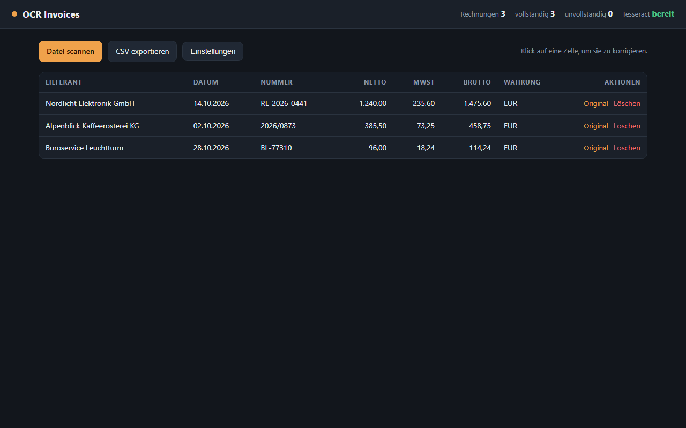
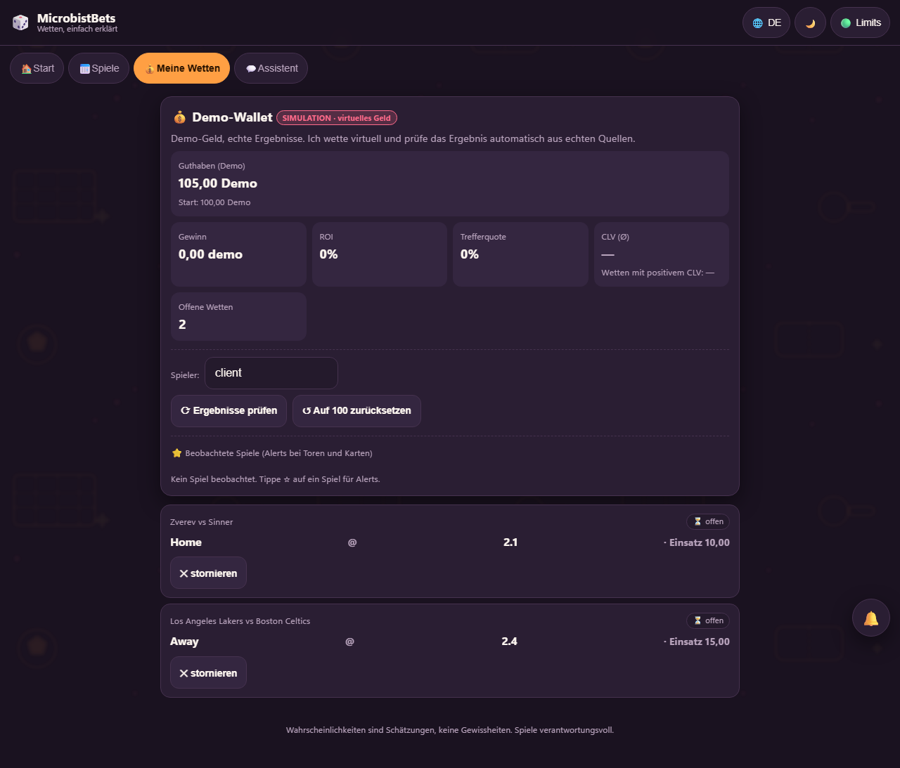
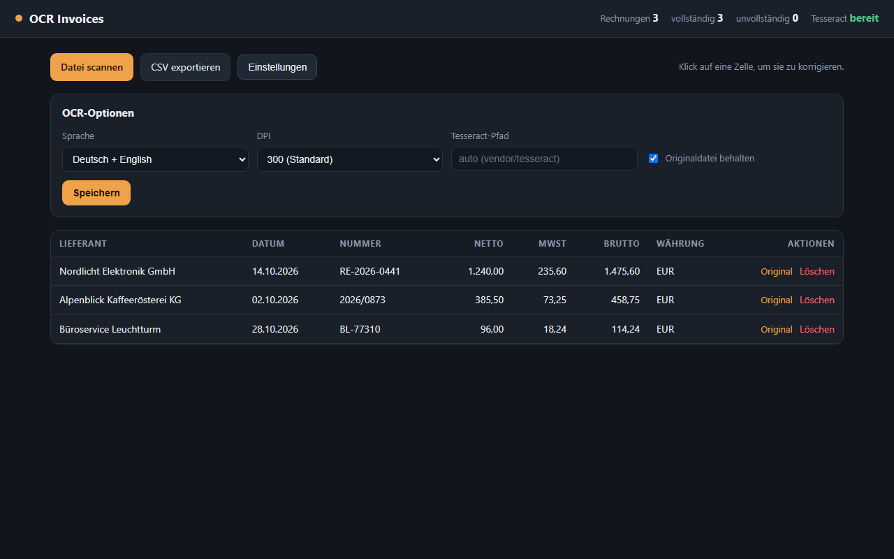

# Portfolio — Johannes Robert Chariton

[](https://github.com/charitonjrobert/portfolio/actions/workflows/e2e.yml)

Junior IT — Support, QA und Automatisierung. Kirchseeon (München Ost), Deutschland.

Drei kleine, fertige Werkzeuge. Keine Tutorials: jedes löst ein konkretes Problem, läuft unter
Windows und nennt sein gemessenes Ergebnis sowie seine Grenzen.

| Projekt | Problem | Nachweis | Stack |
|---|---|---|---|
| [ocr-invoices](ocr-invoices/) | Rechnungen kommen als PDF und werden abgetippt | OCR-Pipeline, Dashboard, Datenmodell, Tests | Python, Tesseract, FastAPI, SQLite |
| [sportsbet-scanner](sportsbet-scanner/) | Quoten von Hand zu vergleichen ist langsam und fehleranfällig | Backend-Design, REST-Integration, Caching, Geschäftslogik | FastAPI, SQLite, Vanilla JS |
| [e2e-tests](e2e-tests/) | Niemand merkt, wenn ein Feature bricht | Testautomatisierung, Page Object, CI | Playwright, pytest |

Zusätzlich als Produkt gebaut, nicht als Code-Beispiel:
[**Reportofon**](https://github.com/charitonjrobert/reportofon) — Android-Diktiergerät mit
Transkription komplett auf dem Gerät (React Native, Whisper, C++/NDK). Dort stehen Screenshots
und eine installierbare Release-APK; der Quellcode bleibt privat (GPL-Komponente).

## Screenshots

| OCR Invoices | MicrobistBets — Demo-Wallet |
|---|---|
|  |  |



## Gemessene Ergebnisse

- **ocr-invoices**: 21 von 21 Feldern korrekt auf drei synthetischen deutschen Rechnungen
  (7 Felder × 3 Dokumente). Fehlende Felder bleiben leer, das Werkzeug rät nie. 13 Tests grün.
- **sportsbet-scanner**: startet lokal mit `config.example.json` ohne Schlüssel; Value-Bet- und
  Arbitrage-Logik durch Modultests abgedeckt.
- **e2e-tests**: 7 Tests grün in 2,8 s gegen die echte Anwendung, frische Datenbank, echtes HTTP.
  Ein echter Startfehler wurde dabei gefunden und behoben.

## Nachgewiesene Fähigkeiten (nicht behauptet)

| Fähigkeit | Sichtbar in |
|---|---|
| Python (strukturiert, typisiert, getestet) | beide Python-Projekte |
| FastAPI / REST-APIs | sportsbet-scanner `backend/` |
| SQL / SQLite-Schema, Duplikaterkennung | `store.py`, Datenmodell |
| OCR / Tesseract / PDF-Rendering | ocr-invoices `ocr.py` |
| Regex-Extraktion und Randfälle | `extract.py` und Tests |
| Testen (pytest, Fixtures, CI ohne Binärdateien) | `tests/` |
| Browser-Automatisierung / E2E | e2e-tests `tests/`, `pages/` |
| CI (GitHub Actions) | e2e-tests `.github/workflows/` |
| Windows-Tooling, portable Abhängigkeiten | `vendor/`, keine Admin-Installation |
| Frontend-Grundlagen (HTML/CSS/JS) | `dashboard/` |

## Starten

```bash
# ocr-invoices
cd ocr-invoices && python -m venv .venv
.venv/Scripts/python -m pip install -r requirements.txt
set PYTHONPATH=src
.venv/Scripts/python -m ocr_invoices --db data/invoices.db scan "sample/*.pdf"
.venv/Scripts/python -m ocr_invoices.web      # Dashboard auf http://127.0.0.1:8020

# sportsbet-scanner
cd sportsbet-scanner
python -m pip install -r requirements.txt
python -m uvicorn main:app --app-dir backend --host 127.0.0.1 --port 8000

# e2e-tests
cd e2e-tests
.venv/Scripts/python -m pytest
```

## Was ich als Nächstes machen würde

- ocr-invoices: Deskew und Binarisierung vor der OCR, Positionstabellen, DATEV-Export.
- sportsbet-scanner: Backend in Services teilen, echte Unit-Tests um den Value-Scan.
- e2e-tests: Zugangssperre mit einer zweiten Instanz abdecken, visueller Regressionstest.

## Lizenz

Alle Rechte vorbehalten. Der Code ist zur Ansicht und Bewertung veröffentlicht; eine
Weiterverwendung bedarf der schriftlichen Zustimmung. Abhängigkeiten Dritter und ihre Lizenzen
stehen in [NOTICE.md](NOTICE.md).

## Hinweis

Mit KI-Unterstützung erstellt (Generierung, Review, Test-Gerüst), von mir entworfen, ausgeführt
und geprüft. Keine Kundendaten, keine API-Schlüssel, keine Inhalte Dritter in diesem Repository.

---

### Summary (English)

Three small tools an invoice OCR pipeline with a dashboard (Python, Tesseract, FastAPI,
SQLite), a betting-odds scanner backend (FastAPI, SQLite, vanilla JS) and a Playwright E2E suite
that tests the scanner. Measured results, tests and limitations are stated in each README.
A fourth project, [Reportofon](https://github.com/charitonjrobert/reportofon), is published as a
product page with installable APK (React Native + Whisper, source private).

Proprietary license, no secrets in the repository. Contact: charitonjrobert@gmail.com
