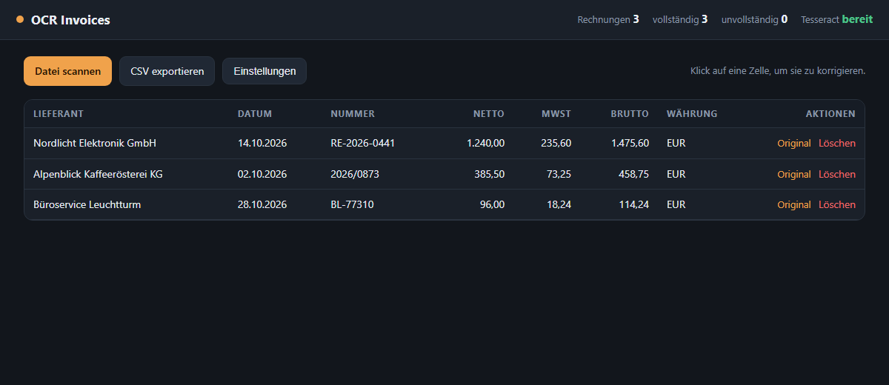

## Kurzfassung (Deutsch)

Liest Rechnungen aus PDF, JPG oder PNG, extrahiert Lieferant, Datum, Rechnungsnummer, Netto,
MwSt, Brutto und Währung und speichert sie in SQLite. Fehlende Felder bleiben leer — das
Werkzeug rät nicht. Bedienung per Kommandozeile und per lokalem Dashboard (Hochladen,
Korrektur per Klick, CSV-Export, OCR-Optionen).

Gemessen: 21 von 21 Feldern auf drei synthetischen Rechnungen, 13 Tests grün.
Grenzen: keine Schräglagen-Korrektur, keine Positionstabellen, kein DATEV-Export.

# ocr-invoices

Read invoices from PDF/JPG/PNG, extract the usual fields, store them in SQLite, export CSV.
Built to replace manual typing in a small business — no cloud, no account, no per-document cost.

## Result (measured, not claimed)

3 synthetic German invoices, 300 DPI, Tesseract 5.3 `deu+eng`:

| Document | Fields found |
|---|---|
| rechnung_001.pdf | 7/7 |
| rechnung_002.pdf | 7/7 |
| rechnung_003.pdf | 7/7 |

**21/21 fields correct (100%).** Caveat: synthetic, clean renders — real scans with skew,
stamps or folds will score lower. Numbers are reproducible with `tools/make_samples.py`.

## Dashboard

There is also a local browser UI, because typing `scan`/`list`/`export` is not how a
bookkeeper wants to work:



```bash
set PYTHONPATH=src
.venv/Scripts/python -m ocr_invoices.web
# http://127.0.0.1:8020
```

What you can do without the terminal:

- upload a PDF or image and scan it;
- click any cell to correct a wrong value (missing fields are highlighted);
- open the original document next to the row;
- delete a row in two steps (no accidental clicks);
- export the whole table as CSV;
- change OCR options: language (`deu+eng` / `deu` / `eng`), DPI (150/300/400),
  Tesseract path, keep-or-drop the original file.

The CLI is unchanged: `scan`, `list`, `export` still work exactly as before.

## What it does

- OCR a PDF (all pages) or an image with Tesseract, German + English.
- Extract: vendor, invoice date, invoice number, net, VAT, gross, currency.
- Missing field stays `null` — the tool never guesses a value.
- De-duplicate on `(vendor, invoice_no)`, so re-scanning does not duplicate rows.
- CLI: `scan`, `list`, `export --csv`.

## How to run

```bash
python -m venv .venv
.venv/Scripts/python -m pip install -r requirements.txt
set PYTHONPATH=src
.venv/Scripts/python -m ocr_invoices --db data/invoices.db scan "sample/*.pdf"
.venv/Scripts/python -m ocr_invoices list
.venv/Scripts/python -m ocr_invoices export --out invoices.csv
```

Tesseract is expected in `vendor/tesseract/tesseract.exe` (portable, no admin rights).
Override with `OCR_TESSERACT_CMD` or install it on `PATH`.

## Architecture

```
src/ocr_invoices/
  ocr.py      PDF -> image -> text (pypdfium2 + pytesseract)
  extract.py  text -> fields (labelled regex, same-line amounts)
  store.py    SQLite, UNIQUE (vendor, invoice_no)
  cli.py      scan / list / export
  models.py   Invoice dataclass, found()/missing()
tools/make_samples.py   generates the demo invoices + ground truth
tests/                  5 tests, no OCR binary required
```

Design choices:

- **Regex first, LLM never by default.** Amounts are taken from the line that carries the
  label, so `MwSt. 19 % 235,60` does not mistake `19` for the value.
- **Same-line rule** instead of "next number in the document" — the main cause of wrong
  field assignment in naive OCR pipelines.
- OCR is isolated behind `ocr.py`, so tests and CI run without the binary.

## Limitations

- Rotated or low-resolution scans reduce accuracy; no deskew yet.
- Multi-page invoices: totals are taken from the first page that contains the label.
- No DATEV/XML export, no line items, no VAT-rate splitting (7%/19% mixed).
- Currency defaults to `null` when no `EUR`/`€` token is recognised.

## What I would build next

1. Deskew + binarisation before OCR (typical +10–20% on phone photos).
2. Line-item table extraction, then DATEV CSV.
3. Confidence per field, with a review screen for the low-confidence ones.
4. Duplicate detection by file hash, not only by invoice number.

## Notes

Built with AI assistance (code generation, review, test scaffolding), designed and verified
by me. No customer data, no API keys, no external services.
