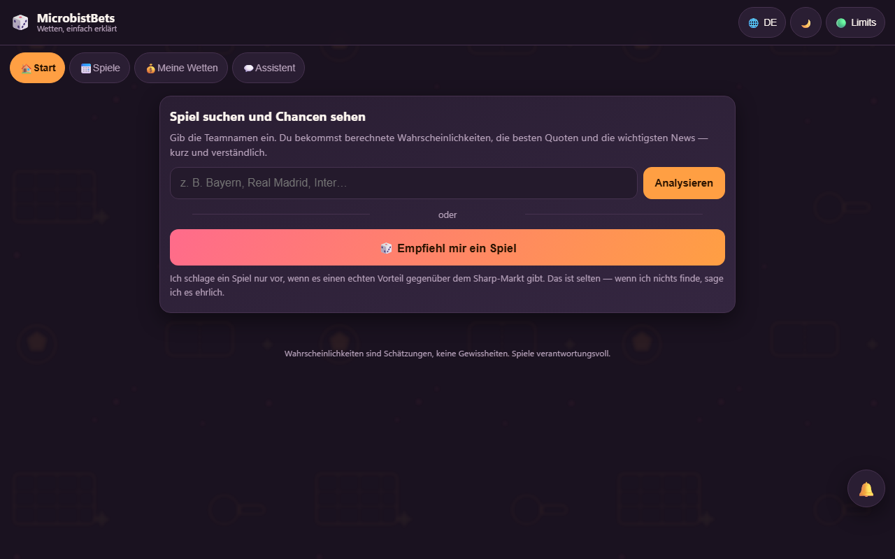
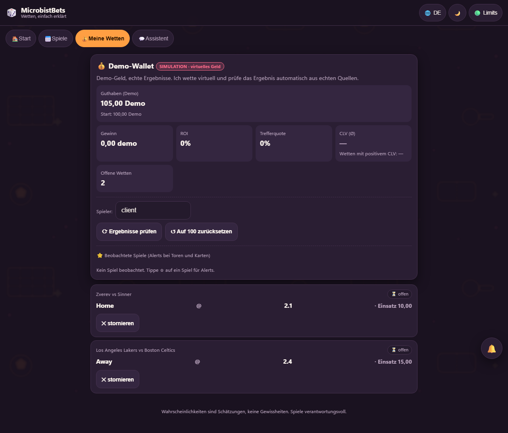
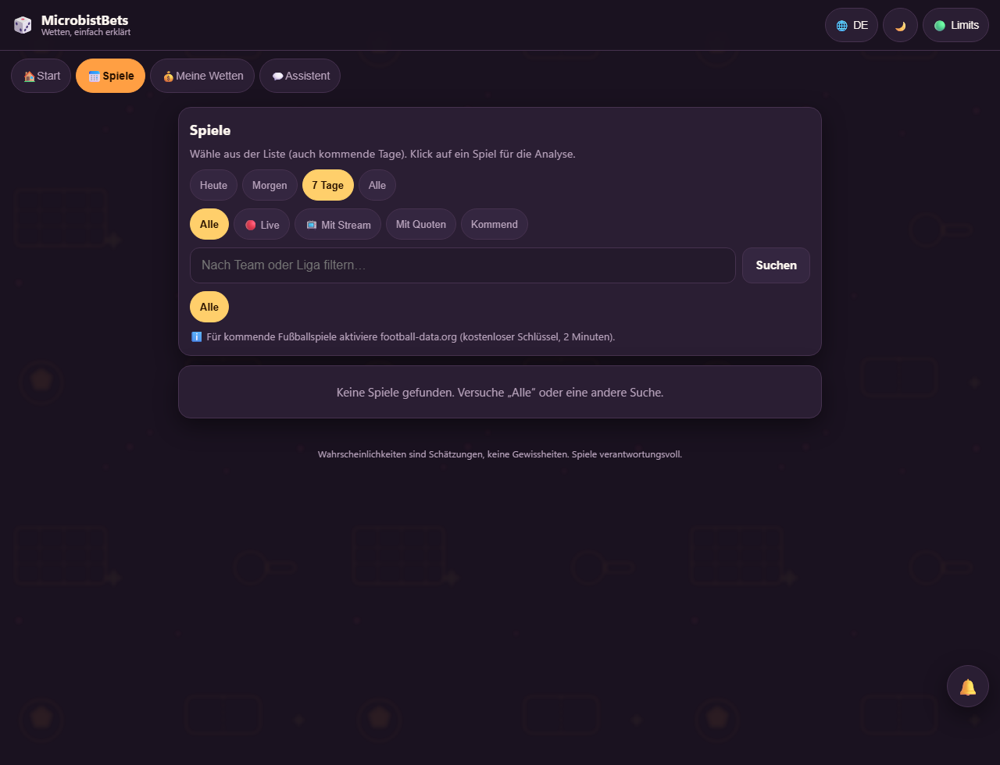

> **Portfolio-Kopie.** Für die Veröffentlichung bereinigt: API-Schlüssel, Zugangsschlüssel,
> Datenbank und Caches entfernt. Läuft lokal mit `backend/config.example.json`; echte Schlüssel
> gehören in `backend/config.json`, um Live-Quoten zu laden. Dies ist nicht die produktive Instanz.

# SportsBet Value Scanner

Quoten-Scanner, der Buchmacher vergleicht und **Value Bets** sowie **Arbitrage** für Fußball,
Tennis, Basketball und Darts markiert.

> **Hinweis:** Kein System garantiert Gewinn. Wetten bergen Verlustrisiken. Dieses Werkzeug
> verbessert nur die Chancen durch Quotenvergleich und Bankroll-Management.

## Screenshots (deutsche Oberfläche)

| Start | Meine Wetten | Spiele |
|---|---|---|
|  |  |  |

## Funktionen

- Live- und Pre-Match-Quoten von mehreren Buchmachern über [the-odds-api.com](https://the-odds-api.com)
- Quoten-Normalisierung zu fairen Wahrscheinlichkeiten (Margen-Entfernung)
- Poisson-Modell (Fußball) und Normalisierung für die übrigen Sportarten
- **Kontext-Engine**: wertet Nachrichten zu Teams und Spielern aus (Verletzungen, Sperren,
  Rückkehr, Ereignisse) über Google News und Bing News/Web und passt die Wahrscheinlichkeiten an
- **KI-Chat (DeepSeek/Ollama)**: Dialog im Dashboard, der die Anwendungsdaten über Tool Calls
  abfragt und bearbeitet (Value Bets, Arbitrage, Team-Kontext, H2H-Historie, Refresh, Statistik).
  Die Persona „Miki" darf keine Zahlen erfinden — jeder Wert stammt aus einem geprüften Tool
- **H2H-Analyse**: Häufigkeit von Ergebnissen, wiederkehrende Muster, Tordurchschnitte und
  Poisson-Lambdas aus echter Historie (als CSV geladen), konservativ integriert
  (mindestens 6 Spiele plus Beimischung der Buchmacher-Wahrscheinlichkeit)
- **Spieler-Impact**: klassifiziert Meldungen (verletzt mit höherem Gewicht, Sperren, Bank,
  Transfers, Rückkehr) und extrahiert Spielernamen
- **Spielanalyse in drei Schritten** (`analyze_match_deep`): Spiel und Quoten → Team-Kontext →
  Spieler mit Ereignissen → Fazit
- **Ligen weltweit**: Katalog mit 78 aktiven Ligen (Fußball aller Länder, NBA/WNBA, NFL, NHL,
  MLB, ATP/WTA, MMA, Boxen, Cricket, Rugby, Golf); jede Liga on-demand per `fetch_league`
  (kostet 1–5 Requests)
- **API-Football (kostenlos, 100 Requests/Tag)**: Schlüssel von
  https://dashboard.api-football.com/register in `config.json` unter `api_football.api_key`.
  Liefert echte Fußballdaten aus allen Ländern inklusive 153 Märkten: 1X2, Doppelte Chance,
  Draw No Bet, BTTS, Halbzeit/Ende, Gerade/Ungerade, exaktes Ergebnis, **Corners**,
  Tor-Gesamtzahl. Im Free-Tarif nur Spiele von **heute** und Saisons 2022–2024
- **Exotische Märkte**: `get_market_odds` lädt auf Anfrage BTTS, Doppelte Chance, Draw No Bet,
  Halbzeit/Ende und Gerade/Ungerade (1 Request pro Spiel, danach im Cache)
- **Gewinner-Hervorhebung**: das Modell setzt das gewählte Team in `<<Team>>`; die Oberfläche
  hebt es farbig hervor, bei Unentschieden beide Teams
- **Animiertes Verdict-Widget**: `[VERDICT] {win_pct, side, event}` zeigt Daumen hoch/runter
  mit hochzählenden Prozentwerten
- **Persistenter Cache**: ein Refresh löscht keine Daten, er aktualisiert nur Ereignisse mit
  derselben ID; on-demand geladene Ligen und exotische Märkte bleiben erhalten, Duplikate
  werden entfernt. `*_lay`-Märkte (Lay-Preise von Börsen wie Betfair) werden ausgeblendet
- **Vertrauens-Score** (1–5★) pro Value Bet aus Edge und bestätigendem Kontext
- Value-Bet-Erkennung (Modellwahrscheinlichkeit > Buchmacherwahrscheinlichkeit)
- Arbitrage-Erkennung (Summe der Wahrscheinlichkeiten < 100 %)
- Bankroll-Management (fraktionales Kelly) und Wett-Historie
- Web-Dashboard

## Installation

```bash
git clone https://github.com/charitonjrobert/portfolio.git
cd portfolio/sportsbet-scanner
python -m venv .venv
.venv/Scripts/python -m pip install -r requirements.txt
```

API-Schlüssel in `backend/config.json` unter `api_key` eintragen (Vorlage:
`backend/config.example.json`).

## Start

```bash
cd backend
python -m uvicorn main:app --host 127.0.0.1 --port 8000
```

Danach **http://127.0.0.1:8000** im Browser öffnen. Ohne Schlüssel startet die Anwendung mit
der Beispielkonfiguration und liefert leere Quoten — sie stürzt nicht ab.

## Bedienung

1. **Refresh Quoten** — lädt Quoten für Premier League, NBA, Tennis und Darts
2. Tab **Value Bets** — Spiele, bei denen die Modellwahrscheinlichkeit über der
   Buchmacherwahrscheinlichkeit liegt (positiver Edge)
3. Tab **Arbitrage** — Kombinationen mit rechnerisch sicherem Gewinn, inklusive proportionaler
   Einsätze
4. Tab **Meine Wetten** — Einsatz erfassen (Kelly-Vorschlag), Ergebnis markieren

## Konfiguration (`backend/config.json`)

| Feld | Bedeutung |
|------|-----------|
| `api_key` | Schlüssel von the-odds-api |
| `regions` | Quoten-Region (`eu`, `uk`, `us`) |
| `markets` | Märkte (`h2h` = 1X2/Sieger, `totals` = Über/Unter) |
| `sports_groups` | Beobachtete Sportarten |
| `preferred_sports` | Bevorzugte Ligen je Sportart |
| `value_threshold_pct` | Mindest-Edge in Prozent für ein Value Bet |
| `kelly_fraction` | Kelly-Anteil für Einsätze (25 % = konservativ) |

### Auto-Refresh (`auto_refresh`)

| Feld | Bedeutung |
|------|-----------|
| `enabled` | Automatischer Refresh im Hintergrund |
| `interval_hours` | Abstand in Stunden (6 h = 12 Requests/Tag, ca. 180/Monat) |
| `refresh_on_startup` | Refresh beim Start, wenn kein Cache existiert |

Status (letzter/nächster Refresh, verbleibende Requests) steht im Dashboard; der Schalter
sitzt neben dem Refresh-Button. Ein vollständiger Refresh kostet 1 Request pro aktiver Sportart.

### KI-Chat (`chat`)

| Feld | Bedeutung |
|------|-----------|
| `api_key` | Optionaler Schlüssel, falls keine Provider aus der opencode-Konfiguration genutzt werden |
| `base_url` | API-Endpunkt (optional, nur mit `api_key`) |
| `model` | Modellname (optional, nur mit `api_key`) |
| `max_iterations` | Maximale Tool Calls pro Konversation |
| `persona` | Personality: `microbist` (Miki) oder Standard |

**Automatische Provider:** Ist `api_key` leer, liest die Anwendung die lokale
opencode-Konfiguration (`~/.config/opencode/opencode.json`) und nutzt dort hinterlegte,
OpenAI-kompatible Provider (zum Beispiel DeepSeek oder lokales Ollama). Provider mit eigenem
Schlüssel haben Vorrang; fällt einer aus, wird der nächste verwendet. In diesem Repository
liegen keine Schlüssel.

### Kontext (`context`)

| Feld | Bedeutung |
|------|-----------|
| `enabled` | Kontextanalyse ein-/ausschalten |
| `news_hl` | Sprache der Meldungen (`en`, `de`, `ro`) |
| `news_cache_hours` | Cache-Dauer der Meldungen |
| `news_lookups_per_scan` | Teams pro Scan (maximal 8) |
| `news_weight` | Gewicht der Meldungen auf die Wahrscheinlichkeit (0.10 = 10 %) |
| `borderline_window_pct` | Edge-Bereich unter der Schwelle, in dem der Kontext entscheidet |

## API

| Endpoint | Bedeutung |
|----------|-----------|
| `GET /api/refresh` | Quoten neu laden (1 Request pro Sportart) |
| `GET /api/refresh/status` | Status des Auto-Refresh |
| `POST /api/refresh/auto` | Auto-Refresh schalten (`{"enabled": true}`) |
| `GET /api/odds` | Quoten aus dem Cache |
| `GET /api/value-bets` | Erkannte Value Bets mit Kontext und Vertrauen |
| `GET /api/context?team=X` | Kontext (Meldungen, Score) für ein Team |
| `GET /api/arbitrage` | Arbitrage-Möglichkeiten |
| `GET /api/bets` | Wett-Historie |
| `POST /api/bets` | Wette anlegen |
| `POST /api/bets/{id}/settle?won=true` | Wette abrechnen |
| `GET /api/stats` | Bankroll-Statistik |
| `POST /api/chat` | Dialog mit der KI (`{"messages": [...]}`), Antwort mit `reply` und `tools_used` |

## Hinweis zum Free-Tarif

Der kostenlose Tarif umfasst **500 Requests pro Monat**. Ein vollständiger Refresh kostet
**1 Request pro Sportart** (4 bei allen Sportarten). Ein Scan pro Tag liegt bei etwa 120 pro
Monat. Quoten bleiben im Cache und sind offline verfügbar, bis der nächste Refresh läuft.
